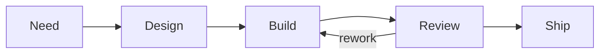

## The idea first: picture-as-text — but text for whom

"Picture-as-text" is a position mermaid and datalink share. Both refuse to
store a picture as a binary; both want it written as characters that can be
diffed, grepped and committed. At this point they shake hands.

The fork comes one step later: **who is this text written for?**

Mermaid's answer: for humans. The picture is a code block; whoever reads the
document reads the picture's structure along the way, and editing the picture
means editing the code. It is the programmer's stance — the source is the
truth, and readability is a hard requirement.

Datalink's answer: for infrastructure. The picture is a URL; whoever reads
the document sees an address, and what the picture looks like must be
rendered to be known. Here the text is not a source for humans but a
transport format — for caches, for proxies, for mail clients, for agents.

Which is right depends on three questions.

**What will edit the picture in the future?** If human hands, the source must
be readable — every edit happens on the code. If an agent, readability stops
mattering: say "split the review into security and performance rounds", and
the agent writes a new code block as fast as it writes a new URL — both are
text to it.

**Where does the picture live?** A code block is part of the document; the
picture is where the document is, and if the picture dies the document loses
a piece. A URL is an object of its own that the document merely references —
a picture is a trackable asset: annotated, re-edited, shared and
collaborated on at the picture, not inside the document.

**Where are the readers?** A code block needs a renderer to become a picture:
GitHub supports mermaid; email, PDF, chat tools and printouts do not. A URL
is an image — and images are thirty-year-old infrastructure. Where the
readers are matters more than what the source looks like.

These questions have no universal answer, so this post renders no verdict.
It takes inventory: what each system can draw, and how the carrier's account
adds up.

## 1. The facts first: no disagreement about the drawing language

x-cmd/draw itself offers `/draw/mermaid` — the same mermaid code, URL-encoded
into the `m=` parameter, comes back as a rendered SVG:

<figure class="post-fig"><figcaption>The code above, carried as a URL. The drawing language is still mermaid's.</figcaption></figure>

Datalink has no quarrel with mermaid's language. The DSL the mermaid
community has built over a decade and more is a good thing, and it has a
seat here.

## 2. What mermaid can draw

mermaid.js is a DSL of remarkably wide syntactic coverage: flowcharts (with
subgraph grouping), sequence diagrams, class diagrams, state diagrams, ER
diagrams, gantt charts, pie charts, git graphs, mindmaps, timelines,
quadrant charts, requirement diagrams — plus the newer additions, the sankey,
XY, C4, block and packet-diagram family. More than a dozen kinds of diagram,
one shared text syntax.

One syntax for everything is mermaid's greatest strength: learn it once and
every diagram is writable. It is also why mermaid spread — one fenced code
block, and a picture is in the document.

## 3. How much of that /draw/mermaid takes today

Measured on x-cmd.com, 2026-11-22:

| mermaid kind | `/draw/mermaid` | note |
| --- | --- | --- |
| graph / flowchart | ✓ | basic syntax renders; subgraph grouping is not wired in (measured: parse error) |
| gantt | ✓ | |
| sequenceDiagram | ✗ | verbatim error: only graph/flowchart and gantt are supported ([x-cmd/draw#44](https://github.com/x-cmd/draw/issues/44)) |
| class, state, ER, mindmap, pie, … | ✗ | same |

If the story ended here, datalink would be a subset of mermaid. But
`/draw/mermaid` is only one of the entrances — for nearly every kind mermaid
draws, the datalink world has another, native way to draw it.

## 4. The inventory, kind by kind: mermaid vs native datalink

| kind | mermaid (code-block route) | `/draw/mermaid` | native datalink | measured |
| --- | --- | --- | --- | --- |
| flowchart | ✓ with subgraph | ✓ basic | archmap · arch2 · cloud (`b=` grouping) | ✓ |
| sequence | ✓ | ✗ | seq (`n=` actors · `e=` messages) | ✓ |
| gantt | ✓ | ✓ | gantt · gantt2 | ✓ |
| class | ✓ | ✗ | class | ✓ |
| state | ✓ | ✗ | lifecycle | ✓ |
| ER | ✓ | ✗ | erd | ✓ |
| mindmap | ✓ | ✗ | mindmap | ✓ |
| pie | ✓ | ✗ | pie (one of 15 `type=` charts) | ✓ |
| sankey | ✓ (newer) | ✗ | sankey | ✓ |
| quadrant | ✓ | ✗ | quadrant | ✓ |
| timeline | ✓ | ✗ | ✗ | missing on both sides |
| git graph | ✓ | ✗ | ✗ | missing on both sides |
| requirement | ✓ | ✗ | ✗ | missing on both sides |
| what mermaid lacks | — | — | chem molecules · tokei code composition · calendar · qr · gauge · echarts · tty · abcjs/wavedrom/jianpu notation · annotate · explore | ✓ |

The table reads on three levels.

First, for the kinds in the overlap, each side has its own grammar. Mermaid
is one DSL for all; datalink is structured parameters per kind — a sequence
diagram declares actors with `n=` and messages with `e=`, structure diagrams
share the `n=`/`e=`/`b=` family, a pie chart is `type=pie` plus labels and
values.

Second, each entry in the extra column on the right is a drawing language
of its own. Molecules, code
composition, calendars, QR codes, gauges and musical notation are kinds
mermaid does not have — its grammar grew around software-engineering
diagrams, and these are not in its field. The datalink kind table is an open
registry with a different boundary.

Third, what both lack (timeline, git graph, requirement diagram) is recorded
honestly. An open registry means "missing" is a public question, not an
embarrassment.

The sequence diagram deserves a look of its own — it is mermaid's most-used
kind, and the one `/draw/mermaid` has not wired in. In datalink it looks
like this:

<figure class="post-fig"><figcaption>The same thing, drawn natively in datalink. Actors and messages are structured parameters, not a DSL.</figcaption></figure>

An agent edits this picture without parsing any grammar: swap
`e=s;u;response` for `e=s;u;202`, or add a line `n=q;bus;Queue` and another
edge `e=s;q;event` — it is just changing key-value pairs.

## 5. The grammar fork: one DSL vs parameters per kind

Mermaid's choice is abstraction: one syntax engine consumes every kind, one
investment for the learner. The cost — an agent that must reliably generate
or modify mermaid has to parse a text grammar with subgraphs, activation
bars and alt/loop blocks. Doable, but not cheap to parse.

Datalink's choice is structure: every kind's parameters are flat key-value
pairs, no grammar to parse, and editing a picture is editing keys. The cost
is a scattered learning surface — each kind's parameter table must be
learned on its own.

For humans, the DSL wins: hand-writing a sequence diagram, mermaid reads
more naturally than `n=`/`e=`. For agents, key-value wins: no grammar to
know, and parameters are data. And the one editing the picture is shifting
from human to agent — the scale is tilting toward key-value.

## 6. Measured: the length and platform accounts

All numbers measured on x-cmd.com, 2026-11-22:

- A five-step flowchart via `/draw/mermaid`: the URL is about **256** characters.
- An 80-step flowchart: about **3.3k** characters — inside the 3.8k comfort
  zone, and GitHub proxies it fine.
- A 120-step flowchart: about **4.9k** characters — past GitHub's ~4096
  proxy length wall; at that size, switch to a short link (POST the spec,
  get `/draw/c/<hash>`).

The code-block route: length is never the problem (the picture is part of
the document), but the renderer is the boss — GitHub and GitLab render
mermaid; email, PDF, chat tools and printouts do not, and their readers see
a piece of code. The URL route has the opposite account: it reaches anywhere
an image renders, but a large picture needs its length managed.

## 7. Choosing

- A plain-text repository, line-level blame a hard requirement, readers known
  to be on platforms that render mermaid (GitHub markdown, say) → the
  code-block route is reasonable; use mermaid's grammar directly.
- Readers spread across email, PDF, chat and the web, or pictures that must
  be annotated, re-edited in explore, or read and written by agents directly
  → the URL route.
- Kinds both sides want → graph and gantt can ride `/draw/mermaid`; the rest
  go through native datalink grammars. mermaid's seat on the URL carrier will
  keep growing ([#44](https://github.com/x-cmd/draw/issues/44) is in motion).

## 8. A shipped picture can still be edited

Beyond the drawing languages there is one more thing: a picture can still
be edited after it ships. A code block, once rendered, is finished; a link
keeps its data in the parameters, so it can be opened, edited, annotated
and re-skinned.

**explore: every picture carries its own editing bench.** Open any picture's
`/draw/explore/<kind>`: the data is readable on hover, parameters show their
effect as you change them, and the new link is one copy away. A picture in a
document no longer needs its "source file redrawn" — the reader is the editor
now.

**annotate: annotations are links too.** Circles, leader lines and comments
drawn on the picture are URL parameters (`_oval`/`_text`/`_hl`/`_note`/
`_arrow`/`_path`) — they travel with the link:

<figure class="post-fig"><figcaption>The circle and the comment are parameters: `_oval` rings the Q2 bar, `_note` is the comment. Annotations travel with the link and every viewer sees them.</figcaption></figure>

Circle a suspicious number in a code review and paste the link back into the
comment — the review note is the picture itself. In one of x-cmd's own
reviews, the agent read the numbers from the URLs and wrote its annotations
back into the URLs — that workflow runs today.

**One dataset, many skins in light and dark.** `scheme=auto` follows the
reader's system, `t=` swaps design families; one link, and the dark-mode
reader gets a dark picture.

**format=png.** Where a raster is required (some mail clients, chat tools),
the same link plus `format=png` gets rasterised on the server — it is still
the same string of characters.

**The echarts escape hatch.** A full ECharts option in `d=` draws whatever
the registry does not cover yet — maps, candlesticks, anything custom.

## Coda: not a verdict, a division of labour

The drawing language is mermaid's strength; the carrier is the URL's.
Datalink stands on the URL side — not to deny the code block, but to bet on
one question: the one editing the picture is more and more an agent. And to
an agent, a code block and a link are both text — it has no preference, only
the context you hand it.
