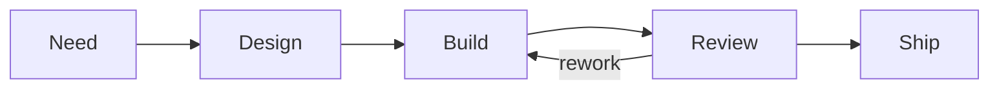

Mermaid is the most popular "picture-as-text" today: a code block pasted into
a document, rendered into a picture by platforms that support it. Datalink
sounds like a rival. First, the facts:

**There is no disagreement about the drawing language.** x-cmd/draw itself
offers `/draw/mermaid` — the same mermaid code, URL-encoded into the `m=`
parameter, comes back as a rendered SVG:

<figure class="post-fig"><figcaption>The code above, carried as a URL. The drawing language is still mermaid's.</figcaption></figure>

Datalink has no quarrel with mermaid's language. The fork is elsewhere.

**The real fork is the carrier: what form a picture takes up residence in a
document as.** The code-block view: the picture travels with the document — it
is a piece of text, readable in the source, and diff, grep and blame all work
on it. The URL view: the document holds only the picture's address — the source
shows one line of link, and you open it to see the picture. Judged only this
far, the code block obviously wins.

Underneath the fork is another question: **what will edit the picture in the
future?**

The code block's answer: human hands. Every edit happens on the code, so the
readability of the source is a hard requirement. The URL's answer: an agent.
A human looks at the picture and makes small adjustments on it — change one
parameter in explore and watch it change; for a complex restructuring, state
the intent ("split the review into security and performance rounds") and hand
the rest to the agent. Writing a code block and writing a URL are equally fast
for an agent — both are text to it. Readability drains out of the human's
requirements and moves to something that never needed it.

At that point the URL trades for a set of things a code block cannot give:

- **No plugin dependency.** A code block needs a renderer to become a picture:
  GitHub supports mermaid; email, PDF, chat tools and printouts do not. A URL
  is an image — and images are thirty-year-old infrastructure. Wherever
  markdown renders an image, the picture arrives.
- **A picture is an asset.** A picture at URL granularity is a trackable
  object: annotate it (`/draw/annotate` — mark it, and every viewer sees the
  mark), re-edit it (change a parameter in explore and copy again), share it
  (that is just copying), collaborate on it (paste the new link back). A code
  block is part of a document; a URL is an object of its own, and a document
  merely references it.

**Honest edges**: today's `/draw/mermaid` accepts only graph and gantt —
sequence diagrams, mermaid's home turf, are not wired in yet
([x-cmd/draw#44](https://github.com/x-cmd/draw/issues/44)). Measured: an
80-step flowchart URLs to about 3.3k characters, still inside the comfort
zone; 120 steps reach about 4.9k and hit GitHub's proxy length wall — at that
size, switch to a short link. For a plain-text repository, or any scene that
needs line-level blame, the code block is still the better fit.

The two routes are not a verdict but a division of labour: the drawing
language is mermaid's strength; the carrier is the URL's. Datalink stands on
the latter — because where the readers are matters more than what the source
looks like, and because the one editing the picture is more and more an agent.
